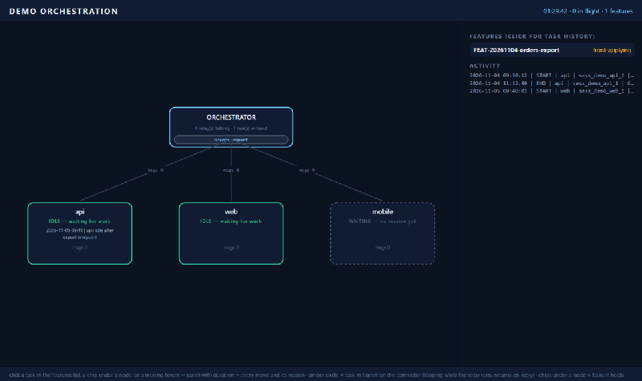
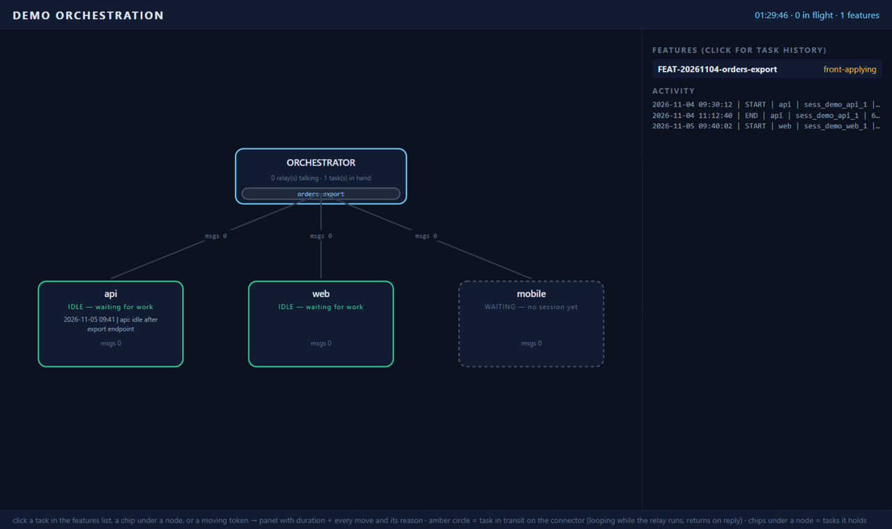
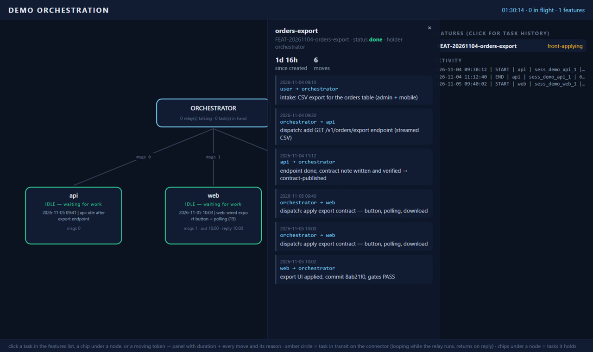
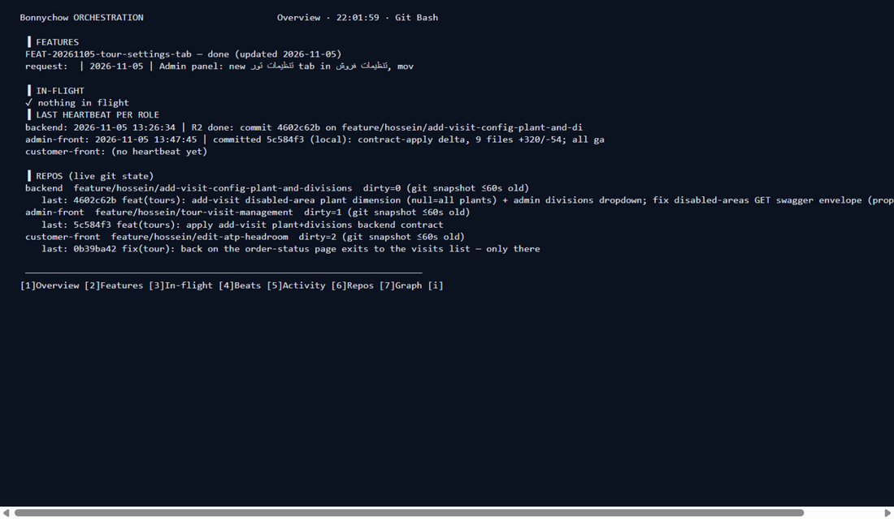

# Ledger-anchored multi-repo agent orchestration

[](LICENSE)
[](AGENTS.md)
[](docs/ADOPTION.md#multi-harness)
[](docs/ARCHITECTURE.md)

An **orchestrator agent** coordinating **role agents** — one persistent
coding-agent session per repository — through a plain-file **ledger**: the
durable, auditable shared state that makes parallel agents safe. Each role
can run on the harness you choose: **ZCode, Claude Code, Codex, or any CLI**.



*Live task flow: the amber token is the task travelling orchestrator → agent
while its relay runs, returning with the reply; chips under nodes show who
holds what; the panel (click any task) shows duration and every move with its
reason.*

| The graph GUI | Task history (click a task) | Terminal dashboard |
|---|---|---|
|  |  |  |

```
                ┌─────────────────────┐
                │     ORCHESTRATOR    │   a ZCode/Claude-Code-style session
                │  (this workspace)   │   running AGENTS.md as its runbook
                └───┬──────┬──────┬───┘
        relay.sh ────┘      │      └──── relay.sh
        (headless CLI)      │            (headless CLI, --resume)
              ┌─────────────┼─────────────┐
              ▼             ▼             ▼
        ┌──────────┐  ┌──────────┐  ┌──────────┐
        │ backend  │  │admin-front│  │cust-front│   persistent sessions, each
        │  agent   │  │  agent   │  │  agent   │   rooted in ITS repo: its
        └──────────┘  └──────────┘  └──────────┘   AGENTS.md/skills/hooks load
              │             │              │        natively
              └──────────── LEDGER ────────┘
              features · transcripts · sessions · heartbeats · activity
              (the only shared state; everything is a plain file)
```

## Multi-harness: mix Claude, Codex, ZCode — whatever fits each role

Every role picks its own harness in `orchestration.json` (see
`orchestration.example.json`):

```json
"roles": {
  "backend": "C:/Projects/my-api",
  "review":  { "repo": "C:/Projects/my-api", "harness": "codex", "model": "…", "worktree": "auto" },
  "web":     { "repo": "C:/Projects/my-web", "harness": "claude", "model": "sonnet" }
}
```

The relay speaks every harness with the **same contract**: transcript out /
reply, raw envelope on disk, session id recorded and resumed, task movement
logged, crash recovery (envelope decode, salvage re-dispatch) identical.
Permission modes map per harness (yolo → `--dangerously-skip-permissions`
/ `--full-auto`; plan → read-only…). Custom CLIs plug in via
`"harnesses": { "mine": { "bin": "…" } }`. Details:
[docs/ADOPTION.md § multi-harness](docs/ADOPTION.md#multi-harness).

Per-role **git worktree isolation** (`"worktree": "auto"`) enables parallel
work in the *same* repo — the claude-squad / agent-teams pattern, one flag.
Optional ledger **auto-commit** (`"auto_commit": true`) keeps the audit
trail pushed after every reply. Hook examples ship for **Telegram
notifications** and **auto PR creation** (`hooks/on-reply.d/*.example`).

## Why this exists

Coding agents are cheap; **collisions are not**. When several agents work
across repos that share an API, two features silently touching the same
endpoint is where mistakes are made. This orchestration makes the race
visible and negotiable instead of lucky:

- **Overlap check before any dispatch** — every new request is compared
  against in-flight/contract-published work across your overlap axes
  (endpoints, schemas, permissions, migrations…). Duplicates are rejected
  and redirected; partial overlaps are negotiated; the verdict is logged.
- **The ledger is the only shared state** — sessions are ephemeral and
  context-limited; the ledger (`ledger/`) is durable and auditable. Every
  message is transcripted; every decision is logged with a reason; every
  relay's duration and token usage is recorded.
- **Session-per-repo role agents** — each role agent is a persistent
  session rooted in its own repo (`--cwd`), so its own conventions, skills,
  and git hooks load natively. The orchestrator never edits product repos.
- **Failure is a first-class flow** — heartbeats, in-flight detection from
  un-replied transcripts, an orphan-marker protocol, salvage-first
  re-dispatch ("audit the dead agent's partial work before redoing"), and
  a watchdog that automates the liveness duty.
- **It learns** — after every feature, the run's lessons are appended to
  `rules/RULES.md`; rules applied mechanically three times graduate into
  tooling. The file ships with 28 rules, most earned in live runs.

## Feature tour

| What | Where |
|------|-------|
| Relay to a role agent on **any harness** (zcode/claude/codex/custom; per-role model & extra args; session resume; attach files; permission modes; dry-run; one-in-flight-per-role guard; `--salvage` crash re-dispatch notice) | `scripts/relay.sh` |
| Per-role git worktree isolation for parallel same-repo work | `orchestration.json` → `"worktree": "auto"` |
| Conflict detection protocol (overlap check, negotiate/reject, single-writer rules) | `rules/RULES.md` R1–R7 |
| Verbatim transcripts, feature lifecycle, session registry, heartbeats, activity log, task movement log | `ledger/` |
| Terminal dashboard (features, in-flight, heartbeats, activity, repos, agent-topology view, inspect menu) | `scripts/dashboard.sh` |
| Browser topology GUI with animated task flow (tokens on connectors, per-agent task chips, click-through move history with reasons) | `scripts/graph.sh` |
| Task tracking (auto-logged orchestrator↔agent movements with reasons) | `ledger/tasks.json` + `scripts/task.sh` |
| Snapshot / follow views | `scripts/watch.sh status\|ui\|live` |
| Open a role's real session in the interactive TUI (refuses while a relay drives it) | `scripts/inspect.sh <role>` |
| Deep health check (config, registry, ledger hygiene, hooks, failures) | `scripts/doctor.sh` |
| Liveness watchdog: decodes the CLI envelope before declaring death — recovers complete replies at zero cost (`--auto-orphan`), else writes the R18 orphan marker | `scripts/watchdog.sh --auto-orphan` |
| Cost report per role/day from the activity log (dispatches, wall time, tokens) | `scripts/stats.sh [--daily\|--json]` |
| Full-text search over every transcript, heartbeat, feature file | `scripts/search.sh [-r role] <pattern>` |
| Contract-gate artifact resolution (fuzzy path verifier) | `scripts/contract-check.sh <repo> <stated-path>` |
| Notification/integration hooks on relay start/reply/fail (webhook example for Discord/Slack/generic) | `hooks/` (`hooks/README.md`) |
| Scaffold this orchestration for YOUR repos | `scripts/init.sh --target <dir>` |

The full comparison against the top open-source orchestration frameworks —
what we adopted from them, what we deliberately skipped, and why — is in
[docs/COMPARISON.md](docs/COMPARISON.md).

## Use it on your project (5 minutes)

Requirements: bash (Git Bash on Windows), node, and a headless
coding-agent CLI (ZCode; `ZCODE_CLI` overrides the path).

```bash
git clone <this-repo> coordination
cd coordination
bash scripts/init.sh --target ../MyCoord --name MyProject \
  --roles api=F:/Projects/my-api,web=F:/Projects/my-web \
  --axes "endpoints,schemas,permissions"
```

That scaffolds a workspace with your roles, a generated `AGENTS.md`
runbook, per-role briefings (`prompts/role-*.md`), an empty ledger, hooks,
and `rules/RULES.md` pre-seeded with everything learned here. Interactive
mode: run it without `--roles` and answer the prompts. Then:

1. `bash scripts/relay.sh --check` — validate CLI/repos/registry; then
   `bash scripts/doctor.sh` for the deep check.
2. Open a coding-agent session **in that directory** — `AGENTS.md` is the
   orchestrator's runbook and loads automatically.
3. Describe a feature in plain words. The orchestrator creates the ledger
   entry, overlap-checks it, dispatches to roles, verifies contracts, and
   comes back to you only for product decisions.
4. Optional but recommended: enable a completion/failure webhook
   (`hooks/README.md`) — dispatches run 20–60 minutes unattended.

Step-by-step guide with all options: [docs/ADOPTION.md](docs/ADOPTION.md).
How the pieces fit: [docs/ARCHITECTURE.md](docs/ARCHITECTURE.md).

## Watching it work

- `bash scripts/dashboard.sh` — full-screen terminal dashboard (`[g]`
  starts the browser graph).
- `bash scripts/graph.sh` — the topology GUI in a browser: orchestrator +
  agents as nodes, edges animate while a relay talks to an agent,
  WORKING/IDLE/WAITING/SILENT states, heartbeats, message counts — and
  **live task flow**: each task is an amber circle that travels along the
  connector to the agent while its relay runs and returns when the agent
  replies; chips under each node list the tasks it holds; clicking a task
  (chip, token, or the features list) opens its panel — duration since
  creation and every move with its own one-line reason.
- `bash scripts/watch.sh live` — follow heartbeats + dispatch log.
- `bash scripts/inspect.sh <role>` — open that agent's actual session in
  the TUI: full transcript, every tool call (Git Bash; refuses while a
  relay drives the role).

## The live workspace this was extracted from

This package is a live coordination workspace's engine, published without
its product data: the ledger ships empty, but `rules/RULES.md` is the real
rulebook — including the postmortem of the first full feature loop (6
relays, ~180 min agent wall time, one dead-relay salvage at zero redo
cost) that became rules R15–R24 (§ run log). The workspace it runs has one
backend and two frontend repos, coordinated as `backend` /
`admin-front` / `customer-front` roles.

## Notes & limits

- `relay.sh`/`inspect.sh` run under **Git Bash on Windows** (they drive the
  machine-local session store); `watch.sh`/`dashboard.sh` run anywhere.
- A role's session id is recorded when its **first** relay completes — a
  role cannot be inspected mid-first-dispatch (heartbeats and the dashboard
  cover that window).
- The ZCode CLI path drifts on app updates — `ZCODE_CLI` env var overrides
  (`scripts/relay.sh --check` verifies it).
- Session ids in `ledger/sessions.json` are machine-local; on a new
  machine, null them out and role sessions recreate on first relay.
- Single orchestrator, human-supervised: this is coordination for one
  product team's repos, not a multi-tenant agent platform — see the
  "deliberately skipped" list in the comparison doc.

## License

MIT — see [LICENSE](LICENSE).
